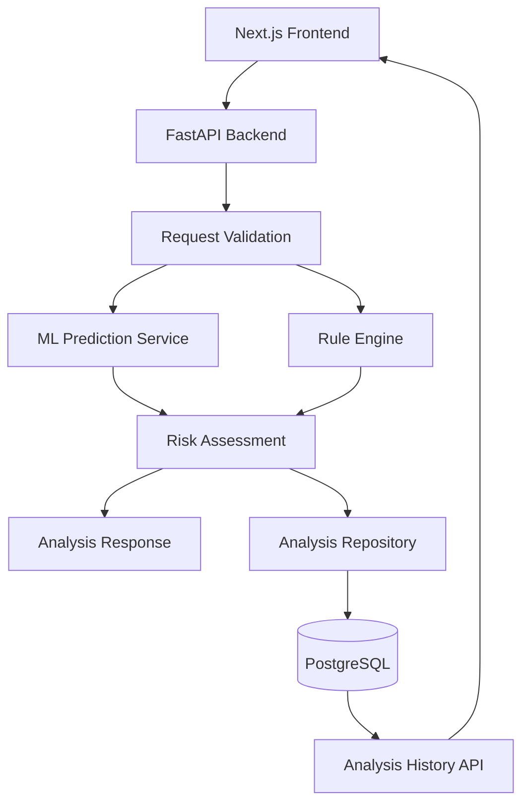

# ScamShield KE — Backend API

**AI-assisted suspicious message screening for Kenya**

[](https://www.python.org/)
[](https://fastapi.tiangolo.com/)
[](https://www.postgresql.org/)
[](https://scikit-learn.org/)

ScamShield KE is an AI-assisted screening tool that helps users identify potentially suspicious SMS messages, job offers, payment requests, and notifications.

This repository contains the FastAPI backend responsible for model inference, rule-based risk assessment, API validation, and persistent analysis history. It combines machine-learning predictions with interpretable warning indicators to provide a structured screening result and practical recommendations.

> **Disclaimer:** ScamShield KE provides risk indicators, not definitive fraud detection. The current model was trained on a general SMS spam dataset, not a representative dataset of Kenyan scams. A low-risk result does not guarantee safety, and a high-risk result does not prove fraud.

---

## Project Repositories

ScamShield KE is organized into independent repositories:

| Component | Repository |
|---|---|
| Backend API | This repository |
| Frontend application | [ScamShield-frontend](https://github.com/WalterOnchieku/ScamShield-frontend) |
| Machine learning pipeline | [ScamShield-ml](https://github.com/WalterOnchieku/ScamShield-ml) |

The frontend provides the user interface, while the ML repository contains the dataset preparation, model training, and evaluation workflow.

**Live application:** *[ScamShield KE.](https://scamshield-frontend-ecru.vercel.app/)*
**Loom Video Demo:** *[SMS Classifier Using TF IDF and Logistic Regression.](https://www.loom.com/share/516177e64f0646cfb5f7c77082453024)*

---

## Features

- **Machine-learning inference:** Classifies submitted messages as `ham` or `spam`.
- **Rule-based screening:** Detects selected suspicious patterns, including urgency, prize claims, credential requests, advance fees, suspicious URLs, and account threats.
- **Risk assessment:** Combines model output and rule findings into an overall risk level.
- **Explainable findings:** Returns detected indicators, severity levels, and recommended precautions.
- **Persistent analysis history:** Stores completed analyses in PostgreSQL.
- **History management:** Supports pagination, risk-level filtering, individual record retrieval, and deletion.
- **Interactive API documentation:** Provides OpenAPI documentation through FastAPI.
- **Automated tests:** Covers API endpoints, prediction behaviour, rule-engine logic, and database operations.

---

## Architecture



### Main components

| Component | Responsibility |
|---|---|
| `main.py` | FastAPI application, lifecycle, and route registration |
| `schemas/` | Request and response validation |
| `services/prediction.py` | Loads and runs the trained classifier |
| `services/rule_engine.py` | Detects configured suspicious patterns |
| `services/analysis.py` | Coordinates analysis and risk assessment |
| `db/` | SQLAlchemy database configuration and models |
| `repositories/analysis.py` | Database persistence and retrieval |
| `migrations/` | Alembic schema migrations |
| `tests/` | Automated backend tests |

---

## Technology Stack

- Python 3.12
- FastAPI and Pydantic
- scikit-learn and Joblib
- SQLAlchemy 2.x
- PostgreSQL and Psycopg 3
- Alembic
- pytest and HTTPX
- Ruff
- Docker Compose for local PostgreSQL development

**Planned hosting:** Render for the API and Supabase for PostgreSQL.

---

## API Reference

The default local API address is `http://127.0.0.1:8000`.

| Method | Endpoint | Description |
|---|---|---|
| `GET` | `/` | Root endpoint |
| `GET` | `/health` | Basic health check |
| `POST` | `/predict` | Runs a model prediction without saving an analysis |
| `POST` | `/analyze` | Performs a full risk assessment and persists the result |
| `GET` | `/history` | Retrieves paginated analysis history |
| `GET` | `/history/{analysis_id}` | Retrieves an individual analysis |
| `DELETE` | `/history/{analysis_id}` | Deletes a saved analysis |

The history endpoint supports `limit`, `offset`, and an optional `risk_level` filter.

### Example: Analyze a message

```bash
curl -X POST "http://127.0.0.1:8000/analyze" \
  -H "Content-Type: application/json" \
  -d '{
    "message": "URGENT! You have won a prize. Pay a processing fee to claim it."
  }'
```

The analysis response includes the predicted label, ham and spam model scores, overall risk level, risk reasons, findings, recommendations, and a disclaimer.

### Interactive documentation

Start the backend and visit:

- Swagger UI: `http://127.0.0.1:8000/docs`
- ReDoc: `http://127.0.0.1:8000/redoc`

---

## Machine Learning Integration

The backend loads the trained pipeline from:

`models/scamshield_baseline.joblib`

The baseline pipeline uses TF-IDF text features and Logistic Regression. It was trained and evaluated in the separate [ScamShield-ml repository](https://github.com/WalterOnchieku/ScamShield-ml).

The held-out evaluation on the prepared UCI SMS Spam Collection reported:

| Metric | Score |
|---|---:|
| Accuracy | 97.68% |
| Spam precision | 90.23% |
| Spam recall | 91.60% |
| Spam F1-score | 90.91% |

These are results on the held-out dataset, not a guarantee of performance on Kenyan fraud messages. The returned classifier scores are not calibrated real-world fraud probabilities.

See the [ML repository](https://github.com/WalterOnchieku/ScamShield-ml) for dataset preparation, training configuration, full evaluation results, and reproducibility instructions.

---

## Database

The backend uses PostgreSQL to persist completed analyses.

The `analysis_records` table stores the submitted message, predicted label, model scores, risk level, risk reasons, findings, recommendations, and creation timestamp.

- SQLAlchemy handles database models and operations.
- The repository layer centralizes persistence and retrieval.
- Alembic manages schema migrations.
- Docker Compose provides the local PostgreSQL development environment.

The production database is planned for Supabase. Production credentials must be configured through environment variables rather than committed to the repository.

**Privacy consideration:** The current history API does not implement authentication or user-scoped records. It should not be treated as a private per-user history service until access controls are added.

---

## Getting Started

### Prerequisites

- Python 3.12
- Git
- Docker Engine and Docker Compose for local PostgreSQL
- The trained model artefact in the expected location

### 1. Clone the repository

```bash
git clone https://github.com/WalterOnchieku/ScamShield-backend.git
cd ScamShield-backend
```

### 2. Create and activate a virtual environment

Linux, macOS, or WSL:

```bash
python3.12 -m venv .venv
source .venv/bin/activate
```

Windows PowerShell:

```powershell
py -3.12 -m venv .venv
.venv\Scripts\Activate.ps1
```

### 3. Install dependencies

```bash
python -m pip install --upgrade pip
pip install -r requirements.txt
```

### 4. Start PostgreSQL

```bash
docker compose up -d
docker compose ps
```

The local Docker Compose configuration maps host port `5433` to PostgreSQL port `5432`.

### 5. Configure the database

Set `DATABASE_URL` to your local PostgreSQL connection string, if needed. For example:

```text
postgresql+psycopg://scamshield:<YOUR_LOCAL_PASSWORD>@localhost:5433/scamshield
```

Replace the placeholder with your local database password. Never commit production credentials.

### 6. Apply database migrations

```bash
alembic upgrade head
```

### 7. Start the API

```bash
uvicorn scamshield.main:app --app-dir src --reload
```

The API should now be available at `http://127.0.0.1:8000`.

---

## Testing and Code Quality

Run the automated test suite:

```bash
pytest
```

Run Ruff:

```bash
python -m ruff check src tests
```

The development test suite has previously reached 55 passing tests, with Ruff checks passing at that checkpoint. Run the commands above against the current checkout to verify its present status.

---

## Deployment

The planned production architecture is:

| Service | Platform | Status |
|---|---|---|
| FastAPI backend | [Render](https://render.com/) | Planned |
| PostgreSQL database | [Supabase](https://supabase.com/) | Planned |
| Frontend | Deployment URL to be added | Planned |

### Render

Configure Render to use the backend repository, install the Python dependencies, and start the API with a command such as:

```bash
uvicorn scamshield.main:app --app-dir src --host 0.0.0.0 --port $PORT
```

Ensure the deployed repository includes the trained model artefact at the path expected by the application.

Set `DATABASE_URL` in the Render environment settings to the appropriate Supabase PostgreSQL connection string.

### Supabase

Create a Supabase project and configure the PostgreSQL connection for the backend. Apply the committed Alembic migrations to the production database:

```bash
alembic upgrade head
```

Verify the connection method and migration configuration before running migrations against production.

### Frontend integration

Configure the deployed frontend to use the public Render API URL through its `NEXT_PUBLIC_API_BASE_URL` environment variable. Configure the backend's CORS policy to allow the actual deployed frontend origin.

These deployment steps describe the intended setup; the services should only be marked as deployed after the live integration has been verified.

---

## Security and Limitations

Before public production use, the project should address:

- Authentication and authorization for analysis history.
- A clear retention and deletion policy for submitted messages.
- Rate limiting and abuse protection.
- Production CORS configuration.
- Secure database credentials and appropriate database access controls.
- Monitoring and more comprehensive dependency-readiness checks.

The classifier and rules can produce false positives and false negatives. ScamShield KE does not independently verify senders, offers, or links and must not be used as the sole basis for high-stakes decisions.

---

## Roadmap

- [x] Train and integrate a baseline SMS classifier.
- [x] Implement prediction and full-analysis endpoints.
- [x] Add rule-based warning indicators.
- [x] Persist analysis history in PostgreSQL.
- [x] Add history retrieval, filtering, and deletion.
- [x] Add database migrations and automated backend tests.
- [ ] Deploy PostgreSQL on Supabase.
- [ ] Deploy the backend on Render.
- [ ] Connect the deployed frontend and backend.
- [ ] Implement authentication and user-scoped history.
- [ ] Improve evaluation with representative Kenyan scam and legitimate-message examples.
- [ ] Add production monitoring and abuse protection.

---

## License

No license has been specified yet. Until a license is added to the repository, reuse and redistribution permissions should not be assumed.
